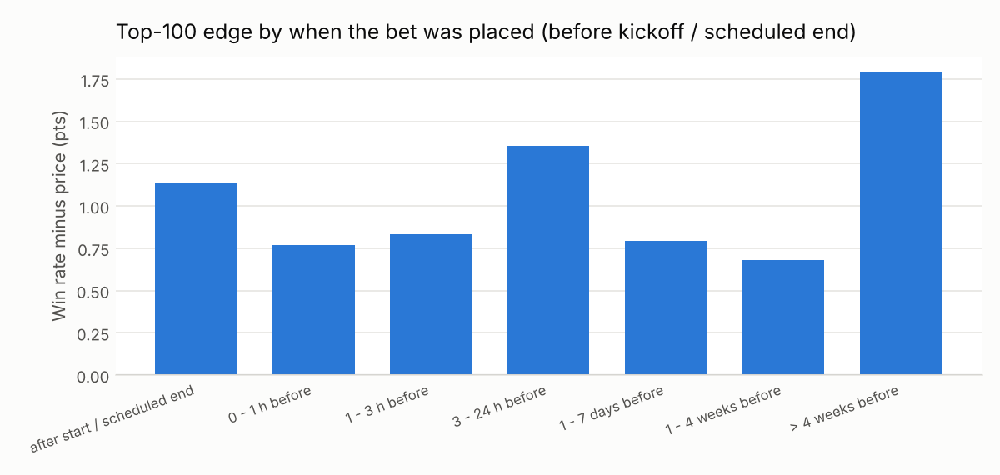

# How the top 100 make money: strategy and integrity tests

2,456,166 trades by the 100 most profitable wallets of the past year, grouped into 232,456 positions (one wallet, one market, one outcome). 69 high-frequency wallets are sampled at up to 2,000 trades a week. **Edge z** compares how often bought outcomes won with how often their prices said they would; |z| > 3 is very unlikely to be luck. The 100 biggest losers are the control group. These are statistical patterns, not findings of wrongdoing.

Timing terms: *before close* is time until the market was settled. *Before start* uses the market's scheduled end date, which for sports game markets is kickoff (they settle about 2 hours later), so negative means bought in-play.

## How they make money: six playbooks

Rule-based labels (`classify` in `polymkt/strategies.py`): parlays = half their volume in combo markets; market making = 100K+ trades a year and buying both outcomes in 30%+ of markets; near-certainty = half of dollars at 95c+; a few huge bets = 30 or fewer positions with 60%+ of dollars in the top five; in-play = 30%+ of dollars after kickoff / scheduled start.

| Playbook | Wallets | Their profit | Median positions | Median win rate | Median avg price |
|---|---:|---:|---:|---:|---:|
| A few huge bets | 27 | $112.6M | 9 | 71% | 0.54 |
| Directional, diversified | 37 | $80.2M | 220 | 55% | 0.51 |
| High-frequency market making | 14 | $72.5M | 5,798 | 52% | 0.51 |
| High-frequency directional | 13 | $45.9M | 1,213 | 50% | 0.49 |
| In-play trading | 6 | $9.7M | 7,537 | 52% | 0.51 |
| Near-certainty harvesting | 2 | $3.3M | 1,026 | 82% | 0.82 |
| Parlays / combos | 1 | $2.3M | 16,564 | nan% | nan |

**92%** of the top 100's buy dollars went into sports, and **15%** into 2026 World Cup markets alone. Across 207,656 resolved positions they won **51.9%** at an average price of **0.51** (edge z = **+11.0**).

## When they bet

Dollar-weighted, per position. Win rate vs. price shows whether bets placed at that moment beat the market.

| Placed | Positions | Avg price | Win rate | Edge z | $ |
|---|---:|---:|---:|---:|---:|
| after start / scheduled end | 101,025 | 0.51 | 52.3% | +8.3 | $323.6M |
| 0 - 1 h before | 25,926 | 0.51 | 51.7% | +2.7 | $599.6M |
| 1 - 3 h before | 10,261 | 0.50 | 50.7% | +1.8 | $189.9M |
| 3 - 24 h before | 35,742 | 0.50 | 51.6% | +5.7 | $309.0M |
| 1 - 7 days before | 26,211 | 0.50 | 50.6% | +3.1 | $149.3M |
| 1 - 4 weeks before | 6,880 | 0.53 | 54.1% | +1.3 | $117.1M |
| > 4 weeks before | 1,611 | 0.59 | 60.3% | +2.1 | $45.4M |

The median wallet's dollar-weighted bet lands **7.3 hours** before the market settles, **94%** of the way through the market's life: they bet late, when most information is already out.

## Edge by category

| Category | Positions | Avg price | Win rate | Edge z | $ |
|---|---:|---:|---:|---:|---:|
| Sports | 193,617 | 0.51 | 51.7% | +10.9 | $1.6B |
| Crypto | 10,318 | 0.54 | 54.7% | +1.4 | $47.3M |
| Geopolitics | 1,007 | 0.54 | 55.5% | +1.7 | $32.3M |
| Economy & Finance | 223 | 0.64 | 65.5% | +0.5 | $18.5M |
| Elections | 170 | 0.70 | 70.0% | +0.1 | $9.3M |
| Politics | 87 | 0.66 | 67.8% | +0.4 | $827.8K |
| Culture | 61 | 0.62 | 59.0% | -0.8 | $479.6K |
| Other | 32 | 0.50 | 53.1% | +0.6 | $189.0K |
| Weather | 2,131 | 0.56 | 56.4% | +0.2 | $182.0K |

## Testing the explanations

### A. "They had inside information" (fixed games, insiders)

The case for: 27 of the top 100 made their money from 30 or fewer positions (together $112.6M). 51% of their dollars went on 2026 World Cup markets, the average dollar was bet 16.8 hours before kickoff, median position $177.9K, and 100% of these wallets first traded within the past year; 65% of their resolved positions won at an average price near 50c. Fresh wallets, a few huge bets close to the event, mostly winners: the textbook insider shape.

The control group: **21 of the 100 biggest losers** have the exact same shape and together lost **$84.2M**. Side by side:

| Group | Wallets | Positions | Win rate | Avg price | Edge z |
|---|---:|---:|---:|---:|---:|
| Winners, few huge bets | 27 | 283 | 65.4% | 0.51 | +5.4 |
| Losers, few huge bets | 21 | 157 | 37.6% | 0.50 | -3.3 |
| **Both together** | 48 | 440 | 55.5% | 0.50 | **+2.3** |

The whole market: every $100.0K+ sports bet by *anyone* placed in the 3 hours before kickoff - 2,540 resolved positions - won 55.6% at an average price of 0.57 (edge z = **-1.3**).

Repeat pre-kickoff whales (5+ such bets): an insider should keep winning; a gambler's record drifts back toward the odds.

| Trader | Bets | Won | Expected from prices | $ bet | Result if held |
|---|---:|---:|---:|---:|---:|
| [0x492442ea...](https://polymarket.com/profile/0x492442eab586f242b53bda933fd5de859c8a3782) | 563 | 276 | 289.2 | $109.6M | $-8.7M |
| [beachboy4](https://polymarket.com/profile/0xc2e7800b5af46e6093872b177b7a5e7f0563be51) | 109 | 57 | 58.4 | $76.1M | $-1.9M |
| [0x2c335066...](https://polymarket.com/profile/0x2c335066fe58fe9237c3d3dc7b275c2a034a0563) | 82 | 57 | 56.7 | $18.2M | $-297.8K |
| [kch123](https://polymarket.com/profile/0x6a72f61820b26b1fe4d956e17b6dc2a1ea3033ee) | 37 | 17 | 20.1 | $6.7M | $-948.2K |
| [gmpm2](https://polymarket.com/profile/0x67542c3219b37fd1610aad290676ff91cdbfe3bc) | 36 | 18 | 21.8 | $8.1M | $-1.4M |
| [Sassy-Bucket](https://polymarket.com/profile/0x4bff30af91642dc7d2b19a8664378fe55c45fc26) | 36 | 19 | 20.7 | $5.5M | $-327.5K |
| [surfandturf](https://polymarket.com/profile/0x9f2fe025f84839ca81dd8e0338892605702d2ca8) | 35 | 19 | 23.1 | $10.7M | $-1.2M |
| [gmanas](https://polymarket.com/profile/0xe90bec87d9ef430f27f9dcfe72c34b76967d5da2) | 35 | 17 | 20.3 | $5.5M | $-893.8K |
| [C.SIN](https://polymarket.com/profile/0x91654fd592ea5339fc0b1b2f2b30bfffa5e75b98) | 30 | 17 | 15.9 | $5.3M | $577.7K |
| [Tiger200](https://polymarket.com/profile/0x6211f97a76ed5c4b1d658f637041ac5f293db89e) | 28 | 12 | 15.2 | $7.6M | $-2.1M |
| [Latina](https://polymarket.com/profile/0x26437896ed9dfeb2f69765edcafe8fdceaab39ae) | 27 | 16 | 15.3 | $7.6M | $679.6K |
| [darkrider11](https://polymarket.com/profile/0x82a1b239e7e0ff25a2ac12a20b59fd6b5f90e03a) | 26 | 15 | 13.5 | $10.2M | $1.1M |
| [weatherman12](https://polymarket.com/profile/0xd1c537b2a7cba8d365e111bffb9de7b205e2cbd0) | 20 | 14 | 10.9 | $10.1M | $2.5M |
| [wasianiversonworldchamp2025](https://polymarket.com/profile/0xb744f56635b537e859152d14b022af5afe485210) | 20 | 9 | 9.6 | $4.8M | $-981.4K |
| [bossoskil1](https://polymarket.com/profile/0xa5ea13a81d2b7e8e424b182bdc1db08e756bd96a) | 19 | 5 | 9.6 | $4.8M | $-3.3M |
| [totoro3miyazaki](https://polymarket.com/profile/0x0f6f76ced62a911bccef92f50faaff143854d977) | 18 | 8 | 9.5 | $8.7M | $131.1K |
| [Dillius](https://polymarket.com/profile/0xed88d69d689f3e2f6d1f77b2e35d089c581df3c4) | 18 | 13 | 12.9 | $4.0M | $-227.8K |
| [0x709e8dcb...](https://polymarket.com/profile/0x709e8dcb133555794decc598e07f2c923b8366f5) | 17 | 10 | 9.9 | $5.1M | $61.7K |
| [bcda](https://polymarket.com/profile/0xb45a797faa52b0fd8adc56d30382022b7b12192c) | 17 | 13 | 9.8 | $2.5M | $900.9K |
| [MrSparklySimpsons](https://polymarket.com/profile/0xd0b4c4c020abdc88ad9a884f999f3d8cff8ffed6) | 16 | 8 | 9.1 | $2.7M | $-515.7K |

**Verdict: not supported.** Big pre-kickoff sports money as a whole won 55.6% against 57% implied (z = -1.3). The winners on the leaderboard are the lucky half of a coin flip; the unlucky half is on the losers' list. This doesn't clear any one wallet, but there is no market-wide sign of fixed matches.

### B. "They know the result before the market does" (in-play speed)

Positions built after kickoff / scheduled start: 101,001, won 52.3% at 0.51 (z = +8.3). For comparison, the last 24 hours before start: 71,953, won 51.5% at 0.50 (z = +6.3). A strong in-play edge would point to faster data feeds or being at the venue ("courtsiding"), which traditional sportsbooks often restrict.

| Trader | Profit | $ after start | Win rate | Edge z |
|---|---:|---:|---:|---:|
| swisstony | $18.5M | 46% | 53.2% | +1.4 |
| RN1 | $12.8M | 62% | 49.4% | +5.8 |
| kch123 | $11.3M | 38% | 52.1% | -1.6 |
| gmanas | $4.9M | 39% | 53.2% | +0.4 |
| GamblingIsAllYouNeed | $4.4M | 53% | 53.5% | +1.9 |
| 0x2a2c53bd... | $3.9M | 43% | 52.6% | +0.7 |
| HomeRunHazard | $3.1M | 35% | 50.9% | +1.0 |
| primm | $2.3M | 34% | 45.9% | -0.5 |
| ferrariChampions2026 | $2.2M | 40% | 48.2% | +1.0 |
| PowerSupplyUnit | $1.7M | 88% | 53.0% | -0.6 |

### C. "They're the house" (market making)

14 wallets ($72.5M) trade hundreds of thousands to millions of times a year in small sizes, buying both sides of the same market (median 50% of markets). Their win rate sits near their average price: they are not predicting, they are earning the spread and Polymarket's liquidity rewards. Legitimate, and the steadiest money on the list.

### D. "Picking up pennies" (near-certain outcomes)

2 wallets ($3.3M) put most of their dollars on outcomes priced 95c+, often after the result is effectively known but before the market settles. Small, steady returns; the risk is a rare upset or a disputed resolution wiping out many wins.

### E. Self-dealing / wash trading

Pairs of top-100 wallets matched in the same settlement transaction: 955. Big traders in the same markets get matched against each other routinely; wash trading would look like the same pair matched constantly with no clear winner. The most frequent pairs:

| Wallet A | Wallet B | Shared transactions |
|---|---|---:|
| RN1 | 0xd9e0aaca... | 2,452 |
| RN1 | swisstony | 1,798 |
| swisstony | 0xd9e0aaca... | 1,747 |
| 0xd9e0aaca... | ferrariChampions2026 | 1,209 |
| RN1 | GamblingIsAllYouNeed | 1,041 |
| GamblingIsAllYouNeed | 0xd9e0aaca... | 850 |
| HomeRunHazard | 0xd9e0aaca... | 782 |
| UpTheBlues | ferrariChampions2026 | 775 |
| swisstony | GamblingIsAllYouNeed | 735 |
| UpTheBlues | 0xd9e0aaca... | 681 |

The public feed doesn't show counterparties, so wash trading with wallets outside the top 100 can't be checked without on-chain data.

### F. Coordinated or copy-trading wallets

Pairs that bought the same outcome in the same market within 10 minutes of each other in 10+ markets. High overlap means copying, a shared signal, or one person running several wallets.

| Wallet A | Wallet B | Same bets | Overlap |
|---|---|---:|---:|
| 0x63ce3421... | k9Q2mX4L8A7ZP3R | 205 | 76% |
| RN1 | 0xd9e0aaca... | 900 | 36% |
| swisstony | 0xd9e0aaca... | 657 | 27% |
| 0xd9e0aaca... | ferrariChampions2026 | 636 | 26% |
| HomeRunHazard | ferrariChampions2026 | 817 | 20% |
| RN1 | swisstony | 1,373 | 19% |
| HomeRunHazard | 0xd9e0aaca... | 411 | 17% |
| sportmaster777 | PowerSupplyUnit | 64 | 16% |
| 0x6e82b93e... | frankfrankfrank | 155 | 15% |
| RN1 | ferrariChampions2026 | 619 | 15% |
| swisstony | GamblingIsAllYouNeed | 568 | 14% |
| curie | 0xd9e0aaca... | 350 | 14% |
| 0x006cc834... | Nooserac | 50 | 13% |
| sportmaster777 | justaluckydude | 1,391 | 13% |
| GamblingIsAllYouNeed | 0xd9e0aaca... | 313 | 13% |

### G. Late long shots outside sports and crypto (real-world insiders)

Single fills of this size are almost never long shots (whales build those from many smaller fills), so this is tested separately in [insider_screen.md](insider_screen.md) using every $5K+ trade.

## Wallet by wallet

| # | Trader | Profit | Playbook | Positions | Top-5 share | Main category | Hrs before settlement | % through market life | Win rate | Avg price | Edge z | New this year |
|---:|---|---:|---|---:|---:|---|---:|---:|---:|---:|---:|---|
| 1 | [swisstony](https://polymarket.com/profile/0x204f72f35326db932158cba6adff0b9a1da95e14) | $18.5M | High-frequency market making * | 12,724 | 10% | Sports 100% | 6.9 | 94% | 53% | 0.53 | +1.4 |  |
| 2 | [RN1](https://polymarket.com/profile/0x2005d16a84ceefa912d4e380cd32e7ff827875ea) | $12.8M | High-frequency market making * | 10,642 | 2% | Sports 100% | 4.1 | 96% | 49% | 0.47 | +5.8 |  |
| 3 | [kch123](https://polymarket.com/profile/0x6a72f61820b26b1fe4d956e17b6dc2a1ea3033ee) | $11.3M | High-frequency market making * | 1,542 | 6% | Sports 100% | 14.5 | 89% | 52% | 0.54 | -1.6 |  |
| 4 | [BreakTheBank](https://polymarket.com/profile/0xf0318c32136c2db7fec88b84869aee6a1106c80c) | $9.6M | High-frequency directional * | 605 | 9% | Sports 99% | 124.4 | 94% | 47% | 0.46 | +0.3 | yes |
| 5 | [mintblade](https://polymarket.com/profile/0x96cfcb0c30942cfcd1cdf76c7d408794d66b1acb) | $9.1M | A few huge bets | 5 | 100% | Sports 100% | 2.8 | 100% | 100% | 0.54 | +2.4 | yes |
| 6 | [fishalive](https://polymarket.com/profile/0xed64a7bf029040aa331abc87902434d815ef217d) | $9.0M | A few huge bets | 2 | 100% | Sports 100% | 3.2 | 100% | 100% | 0.27 | +2.5 | yes |
| 7 | [frostrizz](https://polymarket.com/profile/0xbc11a64ab34a03a043fbe80598fa065ee87eeec6) | $8.8M | A few huge bets * | 6 | 99% | Sports 100% | 2.6 | 100% | 83% | 0.63 | +1.1 | yes |
| 8 | [sparklingwater123](https://polymarket.com/profile/0x664ce9fb97ae1bbd538d7381b2f4e92dab16f49c) | $8.4M | A few huge bets | 4 | 100% | Sports 100% | 2.4 | 100% | 75% | 0.39 | +1.5 | yes |
| 9 | [GRIMDRIP](https://polymarket.com/profile/0x3f87d51f27ba6e19ec52aaeebb68559a839c742c) | $7.5M | A few huge bets | 2 | 100% | Sports 100% | 2.5 | 100% | 100% | 0.40 | +1.8 | yes |
| 10 | [DEEDDIT](https://polymarket.com/profile/0x09b428f7c2b469786286214aa5c90dd9015f7320) | $7.5M | A few huge bets * | 10 | 84% | Sports 100% | 3.8 | 96% | 60% | 0.53 | +0.5 | yes |
| 11 | [endlessFate](https://polymarket.com/profile/0x5e4c3b5b81171e2ca4ab776ac0d6bba787f9dba2) | $7.2M | A few huge bets | 9 | 88% | Sports 100% | 3.5 | 100% | 67% | 0.54 | +0.8 | yes |
| 12 | [beachboy4](https://polymarket.com/profile/0xc2e7800b5af46e6093872b177b7a5e7f0563be51) | $5.8M | Directional, diversified | 235 | 16% | Sports 100% | 7.4 | 94% | 57% | 0.54 | +0.9 | yes |
| 13 | [KeyTransporter](https://polymarket.com/profile/0x94f199fb7789f1aef7fff6b758d6b375100f4c7a) | $5.7M | A few huge bets | 15 | 88% | Sports 100% | 6.1 | 98% | 73% | 0.57 | +1.3 | yes |
| 14 | [joseph00677](https://polymarket.com/profile/0xcdcccd0f2d86e450d973da415ad2430e5cc7935a) | $5.3M | A few huge bets | 23 | 64% | Sports 100% | 4.1 | 99% | 45% | 0.56 | -1.0 | yes |
| 15 | [0x2c335066...](https://polymarket.com/profile/0x2c335066fe58fe9237c3d3dc7b275c2a034a0563) | $5.0M | High-frequency directional * | 5,167 | 7% | Sports 99% | 7.2 | 93% | 52% | 0.51 | +1.4 |  |
| 16 | [gmanas](https://polymarket.com/profile/0xe90bec87d9ef430f27f9dcfe72c34b76967d5da2) | $4.9M | High-frequency market making * | 1,727 | 8% | Sports 97% | 7.7 | 90% | 53% | 0.53 | +0.4 | yes |
| 17 | [0x006cc834...](https://polymarket.com/profile/0x006cc834cc092684f1b56626e23bedb3835c16ea) | $4.7M | Directional, diversified | 432 | 9% | Sports 98% | 61.6 | 78% | 52% | 0.50 | +0.7 |  |
| 18 | [DrPufferfish](https://polymarket.com/profile/0xdb27bf2ac5d428a9c63dbc914611036855a6c56e) | $4.7M | High-frequency directional * | 501 | 12% | Sports 100% | 18.4 | 87% | 45% | 0.41 | +1.7 |  |
| 19 | [432614799197](https://polymarket.com/profile/0xdc876e6873772d38716fda7f2452a78d426d7ab6) | $4.5M | High-frequency directional * | 1,213 | 21% | Sports 100% | 10.5 | 91% | 52% | 0.49 | +2.3 | yes |
| 20 | [sainttroplay](https://polymarket.com/profile/0x9319a045cdd0c2180e5eb7ad44374383db9a6410) | $4.4M | A few huge bets | 14 | 79% | Sports 100% | 5.4 | 97% | 71% | 0.43 | +2.2 | yes |
| 21 | [GamblingIsAllYouNeed](https://polymarket.com/profile/0x507e52ef684ca2dd91f90a9d26d149dd3288beae) | $4.4M | High-frequency market making * | 5,434 | 4% | Sports 100% | 9.3 | 94% | 53% | 0.52 | +1.9 | yes |
| 22 | [Allezpapa](https://polymarket.com/profile/0xe549581668a5751c1972d3ad2d1991d900bd2d54) | $4.1M | Directional, diversified * | 75 | 29% | Sports 100% | 47.5 | 81% | 44% | 0.43 | +0.2 | yes |
| 23 | [vito3corleone](https://polymarket.com/profile/0x34dd4a4b70eaf79a17878f7938263c801d4dfd83) | $4.1M | A few huge bets | 16 | 75% | Sports 100% | 3.5 | 99% | 62% | 0.54 | +0.7 | yes |
| 24 | [0x2a2c53bd...](https://polymarket.com/profile/0x2a2c53bd278c04da9962fcf96490e17f3dfb9bc1) | $3.9M | High-frequency market making * | 759 | 14% | Sports 100% | 15.0 | 91% | 53% | 0.52 | +0.7 | yes |
| 25 | [Inaccuratestake](https://polymarket.com/profile/0xf8831548531d56ad6a4331493243c447a827cd1f) | $3.8M | Directional, diversified | 31 | 70% | Sports 100% | 7.8 | 84% | 73% | 0.64 | +1.2 | yes |
| 26 | [SeriouslySirius](https://polymarket.com/profile/0x16b29c50f2439faf627209b2ac0c7bbddaa8a881) | $3.8M | High-frequency directional * | 1,758 | 10% | Sports 100% | 9.2 | 88% | 50% | 0.49 | +0.7 |  |
| 27 | [reachingthesky](https://polymarket.com/profile/0xefbc5fec8d7b0acdc8911bdd9a98d6964308f9a2) | $3.7M | A few huge bets | 9 | 96% | Sports 100% | 4.8 | 99% | 44% | 0.40 | +0.3 | yes |
| 28 | [majorexploiter](https://polymarket.com/profile/0x019782cab5d844f02bafb71f512758be78579f3c) | $3.7M | A few huge bets | 3 | 100% | Sports 100% | 5.3 | 98% | 100% | 0.61 | +1.4 | yes |
| 29 | [ndb1](https://polymarket.com/profile/0xfea31bc088000ff909be1dfd8d0e3f2c7ef2d227) | $3.6M | Directional, diversified * | 2,633 | 32% | Sports 73% | 226.1 | 93% | 65% | 0.65 | -0.4 | yes |
| 30 | [asparagus2012](https://polymarket.com/profile/0x476e1322d1a412fa0325527b8c3bc5e707b1396d) | $3.5M | A few huge bets * | 16 | 88% | Sports 100% | 130.9 | 89% | 69% | 0.37 | +2.9 | yes |
| 31 | [00gringo00](https://polymarket.com/profile/0x51698a47f840a242abc2ca0351371c7ffac41842) | $3.5M | A few huge bets | 8 | 82% | Sports 100% | 5.1 | 99% | 75% | 0.60 | +0.9 | yes |
| 32 | [0x5966db1f...](https://polymarket.com/profile/0x5966db1fe50763c9e3c014d756369bad07e1f804) | $3.5M | Directional, diversified * | 182 | 20% | Sports 98% | 5.4 | 95% | 60% | 0.52 | +2.2 | yes |
| 33 | [omnibus-076daa](https://polymarket.com/profile/0x076daa87c4fe1a85402a9b6b8e0a866224388d4c) | $3.4M | High-frequency directional * | 15,339 | 8% | Sports 100% | 12.3 | 89% | 50% | 0.50 | -0.9 | yes |
| 34 | [sovereign2013](https://polymarket.com/profile/0xee613b3fc183ee44f9da9c05f53e2da107e3debf) | $3.4M | High-frequency market making * | 7,064 | 3% | Sports 100% | 11.8 | 76% | 50% | 0.50 | +0.5 |  |
| 35 | [HomeRunHazard](https://polymarket.com/profile/0x5268527977f700f9bf9b6d5cd843859e4e70135d) | $3.1M | High-frequency market making * | 8,493 | 2% | Sports 100% | 4.3 | 90% | 51% | 0.50 | +1.0 | yes |
| 36 | [gmpm](https://polymarket.com/profile/0x14964aefa2cd7caff7878b3820a690a03c5aa429) | $2.9M | Directional, diversified * | 789 | 9% | Sports 100% | 15.8 | 87% | 54% | 0.52 | +1.0 |  |
| 37 | [weflyhigh](https://polymarket.com/profile/0x03e8a544e97eeff5753bc1e90d46e5ef22af1697) | $2.9M | High-frequency directional * | 471 | 10% | Sports 100% | 15.8 | 92% | 50% | 0.50 | -0.0 | yes |
| 38 | [gfjoigfsjoigsjoi](https://polymarket.com/profile/0x36a3f17401e395ef4cb1b7f42bcdb8ab8e15fafb) | $2.7M | Directional, diversified | 23 | 59% | Sports 100% | 6.3 | 96% | 70% | 0.56 | +1.4 | yes |
| 39 | [fengdubiying](https://polymarket.com/profile/0x17db3fcd93ba12d38382a0cade24b200185c5f6d) | $2.7M | Directional, diversified | 85 | 64% | Sports 89% | 45.8 | 86% | 75% | 0.73 | +0.4 |  |
| 40 | [LaBradfordSmith22](https://polymarket.com/profile/0x9495425feeb0c250accb89275c97587011b19a27) | $2.6M | High-frequency directional * | 1,164 | 26% | Sports 100% | 8.4 | 94% | 50% | 0.49 | +0.4 | yes |
| 41 | [BAREFLUX](https://polymarket.com/profile/0xd6505aab3c6bef32ae6c96dbd8023d7c4df114fb) | $2.6M | A few huge bets * | 3 | 100% | Sports 100% | 2.5 | 100% | 67% | 0.54 | +0.4 | yes |
| 42 | [geniusMC](https://polymarket.com/profile/0x0b9cae2b0dfe7a71c413e0604eaac1c352f87e44) | $2.3M | High-frequency directional * | 528 | 37% | Sports 86% | 91.8 | 90% | 83% | 0.80 | +2.0 |  |
| 43 | [primm](https://polymarket.com/profile/0xd38b71f3e8ed1af71983e5c309eac3dfa9b35029) | $2.3M | In-play trading * | 2,589 | 8% | Sports 100% | 7.1 | 94% | 46% | 0.46 | -0.5 |  |
| 44 | [blackwall](https://polymarket.com/profile/0xac44cb78be973ec7d91b69678c4bdfa7009afbd7) | $2.3M | A few huge bets | 8 | 96% | Sports 100% | 5.8 | 98% | 62% | 0.57 | +0.3 | yes |
| 45 | [MumiaTriste](https://polymarket.com/profile/0x1109da04152c38666464f5adb5d7c55618810b2c) | $2.3M | Parlays / combos * | 16,564 | 4% | Combos | 0.0 | 0% | nan% | nan | +nan | yes |
| 46 | [Kch-Temp](https://polymarket.com/profile/0x924379a79c64b77ad5816ad362122a5f6228658e) | $2.3M | Directional, diversified * | 318 | 9% | Sports 100% | 9.3 | 96% | 56% | 0.51 | +2.0 | yes |
| 47 | [ferrariChampions2026](https://polymarket.com/profile/0xfe787d2da716d60e8acff57fb87eb13cd4d10319) | $2.2M | High-frequency market making * | 6,161 | 6% | Sports 100% | 2.5 | 96% | 48% | 0.48 | +1.0 | yes |
| 48 | [THEHIGHLIFE](https://polymarket.com/profile/0x8c0b024c17831a0dde038547b7e791ae6a0d7aa5) | $2.2M | High-frequency directional * | 4,745 | 2% | Sports 99% | 5.2 | 91% | 50% | 0.46 | +5.6 | yes |
| 49 | [Jsram](https://polymarket.com/profile/0x83720820a8aa6c3f20ad71850e7a1a17d16c5223) | $2.1M | Directional, diversified * | 2,988 | 16% | Sports 97% | 200.5 | 94% | 55% | 0.54 | +0.3 |  |
| 50 | [CandleHammerDrums](https://polymarket.com/profile/0x7c1ee865a785de4c00ee90ed86a38489fb8bbab3) | $2.1M | High-frequency market making * | 5,085 | 14% | Sports 100% | 7.1 | 97% | 49% | 0.49 | +0.7 | yes |
| 51 | [FeatherLeather](https://polymarket.com/profile/0xd25c72ac0928385610611c8148803dc717334d20) | $2.1M | A few huge bets | 9 | 97% | Sports 100% | 5.4 | 98% | 78% | 0.52 | +1.6 | yes |
| 52 | [hot2trot](https://polymarket.com/profile/0xb61b2079b95f6b7476fd3203e0274ffb93308a06) | $2.1M | Directional, diversified * | 51 | 30% | Sports 100% | 13.4 | 90% | 59% | 0.48 | +1.5 | yes |
| 53 | [0x63ce3421...](https://polymarket.com/profile/0x63ce342161250d705dc0b16df89036c8e5f9ba9a) | $2.1M | Near-certainty harvesting * | 1,630 | 4% | Crypto 99% | 65.0 | 98% | 74% | 0.72 | +2.4 | yes |
| 54 | [denizz](https://polymarket.com/profile/0xbaa2bcb5439e985ce4ccf815b4700027d1b92c73) | $2.0M | Directional, diversified * | 764 | 15% | Geopolitics 84% | 912.6 | 50% | 55% | 0.54 | +1.0 |  |
| 55 | [HorizonSplendidView](https://polymarket.com/profile/0x02227b8f5a9636e895607edd3185ed6ee5598ff7) | $2.0M | Directional, diversified | 20 | 60% | Sports 100% | 5.3 | 98% | 50% | 0.50 | +0.0 | yes |
| 56 | [Supah9ga](https://polymarket.com/profile/0x57cd939930fd119067ca9dc42b22b3e15708a0fb) | $2.0M | Directional, diversified * | 644 | 9% | Sports 100% | 6.2 | 97% | 52% | 0.51 | +0.4 |  |
| 57 | [muchobliged](https://polymarket.com/profile/0x095fbca2e0eaf0c9841005135427e1e0117190b2) | $2.0M | A few huge bets * | 18 | 68% | Sports 100% | 2.7 | 97% | 72% | 0.56 | +1.4 | yes |
| 58 | [0xf705fa04...](https://polymarket.com/profile/0xf705fa045201391d9632b7f3cde06a5e24453ca7) | $1.9M | Directional, diversified * | 3,293 | 4% | Crypto 99% | 372.2 | 66% | 48% | 0.48 | -0.2 |  |
| 59 | [CemeterySun](https://polymarket.com/profile/0x37c1874a60d348903594a96703e0507c518fc53a) | $1.9M | High-frequency directional * | 1,041 | 27% | Sports 100% | 6.8 | 89% | 52% | 0.49 | +2.0 | yes |
| 60 | [gmpm2](https://polymarket.com/profile/0x67542c3219b37fd1610aad290676ff91cdbfe3bc) | $1.8M | Directional, diversified * | 606 | 19% | Sports 100% | 7.7 | 97% | 53% | 0.53 | +0.0 | yes |
| 61 | [weatherman12](https://polymarket.com/profile/0xd1c537b2a7cba8d365e111bffb9de7b205e2cbd0) | $1.8M | Directional, diversified * | 35 | 40% | Sports 100% | 4.1 | 99% | 49% | 0.50 | -0.2 | yes |
| 62 | [skyblue77](https://polymarket.com/profile/0x97cb27132b9dd66a2ef49390893cbeb26c3fe4d0) | $1.8M | A few huge bets | 19 | 64% | Sports 100% | 13.7 | 98% | 63% | 0.49 | +1.2 | yes |
| 63 | [lovelystuff](https://polymarket.com/profile/0x65b54274eba5c76dee6f0fab18a590653811e82f) | $1.8M | A few huge bets | 9 | 93% | Sports 100% | 9.6 | 96% | 50% | 0.61 | -0.7 | yes |
| 64 | [frankfrankfrank](https://polymarket.com/profile/0xea2b4224411e723499a803ce3f4758779fb31fc6) | $1.8M | Directional, diversified * | 1,390 | 8% | Sports 100% | 15.9 | 89% | 55% | 0.53 | +1.2 |  |
| 65 | [PowerSupplyUnit](https://polymarket.com/profile/0x6db568e61e5e3de7d87f831431b673f38ce2e279) | $1.7M | In-play trading | 729 | 12% | Sports 100% | 1.8 | 99% | 53% | 0.54 | -0.6 | yes |
| 66 | [ramadamaramadam](https://polymarket.com/profile/0x5b4ec9c06b284ee52c41a761974d836992880232) | $1.7M | Directional, diversified * | 72 | 26% | Sports 100% | 10.4 | 87% | 49% | 0.50 | -0.2 | yes |
| 67 | [Diabolical-Prize](https://polymarket.com/profile/0x7c37b52eb226bcb9411375ec48b0169663fb6aeb) | $1.7M | Directional, diversified * | 220 | 11% | Sports 100% | 4.2 | 89% | 46% | 0.49 | -0.7 | yes |
| 68 | [palegrit](https://polymarket.com/profile/0xf5fabdcdc6eb6d9765a228824f16cca9c91f62df) | $1.7M | A few huge bets | 24 | 67% | Sports 100% | 5.0 | 88% | 75% | 0.70 | +0.6 | yes |
| 69 | [Talvez10](https://polymarket.com/profile/0xa71093cafc0c099b4ccab24c3cb8018d817923c4) | $1.6M | Directional, diversified * | 1,440 | 3% | Sports 100% | 11.5 | 83% | 50% | 0.47 | +1.9 | yes |
| 70 | [jtwyslljy](https://polymarket.com/profile/0x9cb990f1862568a63d8601efeebe0304225c32f2) | $1.6M | High-frequency directional * | 2,905 | 4% | Sports 100% | 7.0 | 92% | 43% | 0.42 | +1.4 |  |
| 71 | [curie](https://polymarket.com/profile/0xd1ed12197b7dc22dede923727e9b714024dbd7cb) | $1.6M | High-frequency market making * | 21,259 | 4% | Sports 95% | 5.0 | 92% | 53% | 0.52 | +2.4 |  |
| 72 | [cnyek](https://polymarket.com/profile/0x65018f9fc473f6e920b8929a375d39c26a461220) | $1.6M | Directional, diversified | 86 | 30% | Sports 100% | 21.9 | 93% | 59% | 0.48 | +2.2 | yes |
| 73 | [afghj2421](https://polymarket.com/profile/0xb91aeb5accc33a5f9a8615b8ed6b2d352e913987) | $1.6M | Directional, diversified * | 94 | 12% | Sports 100% | 6.1 | 88% | 61% | 0.50 | +2.0 | yes |
| 74 | [0x876426b5...](https://polymarket.com/profile/0x876426b52898c295848f56760dd24b55eda2604a) | $1.6M | A few huge bets * | 15 | 77% | Sports 100% | 6.8 | 92% | 60% | 0.44 | +1.3 | yes |
| 75 | [kilian7kilian](https://polymarket.com/profile/0x14c7111afa871fb215339f365043d7b2837b9ccf) | $1.5M | Directional, diversified | 25 | 55% | Sports 100% | 4.4 | 98% | 60% | 0.56 | +0.5 | yes |
| 76 | [Nooserac](https://polymarket.com/profile/0xf68a281980f8c13828e84e147e3822381d6e5b1b) | $1.5M | In-play trading * | 9,478 | 2% | Sports 99% | 83.3 | 89% | 53% | 0.51 | +3.7 |  |
| 77 | [S-Works](https://polymarket.com/profile/0xee00ba338c59557141789b127927a55f5cc5cea1) | $1.5M | Directional, diversified * | 1,781 | 10% | Sports 100% | 30.9 | 91% | 65% | 0.63 | +1.8 |  |
| 78 | [Grenderen](https://polymarket.com/profile/0x4761ecf3578e388a9b16c43f874efe32ee855ae8) | $1.5M | Directional, diversified * | 30 | 49% | Sports 100% | 6.1 | 99% | 50% | 0.40 | +1.2 | yes |
| 79 | [vanjie](https://polymarket.com/profile/0xc1da9728491b4d25480a771bbf932dbeddc5fefa) | $1.5M | Directional, diversified * | 24 | 51% | Sports 100% | 11.8 | 98% | 46% | 0.48 | -0.2 | yes |
| 80 | [MrSparklySimpsons](https://polymarket.com/profile/0xd0b4c4c020abdc88ad9a884f999f3d8cff8ffed6) | $1.5M | Directional, diversified * | 571 | 7% | Sports 100% | 12.5 | 90% | 52% | 0.52 | +0.3 | yes |
| 81 | [Soarin22](https://polymarket.com/profile/0x84dbb7103982e3617704a2ed7d5b39691952aeeb) | $1.5M | Directional, diversified * | 1,740 | 3% | Sports 100% | 14.6 | 91% | 52% | 0.51 | +1.6 |  |
| 82 | [Flaznorp](https://polymarket.com/profile/0x821dab0565ebf5b327f51db06223fdcfe01acf16) | $1.4M | In-play trading * | 5,596 | 14% | Sports 100% | 4.3 | 97% | 51% | 0.52 | -0.9 | yes |
| 83 | [thesingularityisnear](https://polymarket.com/profile/0x3a6a2e7a7707c720219228eb8efa7398bc0e458e) | $1.4M | A few huge bets * | 14 | 63% | Sports 55% | 195.5 | 97% | 40% | 0.27 | +1.2 | yes |
| 84 | [justaluckydude](https://polymarket.com/profile/0xbca08c1bc204a34f2fddbe47b438b9bd42ac9705) | $1.4M | High-frequency market making * | 18,482 | 3% | Sports 100% | 2.8 | 91% | 53% | 0.52 | +3.1 | yes |
| 85 | [k9Q2mX4L8A7ZP3R](https://polymarket.com/profile/0xd0d6053c3c37e727402d84c14069780d360993aa) | $1.4M | High-frequency market making * | 516 | 9% | Crypto 100% | 0.6 | 98% | 50% | 0.47 | +1.2 | yes |
| 86 | [wan123](https://polymarket.com/profile/0xde7be6d489bce070a959e0cb813128ae659b5f4b) | $1.4M | Directional, diversified * | 643 | 16% | Geopolitics 38% | 390.8 | 77% | 39% | 0.37 | +1.2 | yes |
| 87 | [0xd9e0aaca...](https://polymarket.com/profile/0xd9e0aaca471f489be338fd0f91a26e8669a805f2) | $1.4M | High-frequency market making * | 4,632 | 4% | Sports 100% | 3.1 | 96% | 50% | 0.49 | +1.6 |  |
| 88 | [filthybetz](https://polymarket.com/profile/0xc6a63ad5a788a576d4acc9911c50fef9fde49458) | $1.4M | Directional, diversified * | 72 | 33% | Sports 100% | 9.5 | 91% | 53% | 0.44 | +1.6 | yes |
| 89 | [sportmaster777](https://polymarket.com/profile/0x32ed517a571c01b6e9adecf61ba81ca48ff2f960) | $1.4M | In-play trading * | 14,738 | 3% | Sports 100% | 4.7 | 89% | 53% | 0.50 | +8.3 |  |
| 90 | [UpTheBlues](https://polymarket.com/profile/0x2a69660046d7acc4ab204d7cc5ba78b0776cd2f7) | $1.3M | In-play trading * | 15,259 | 5% | Sports 100% | 5.3 | 97% | 51% | 0.51 | +0.8 | yes |
| 91 | [RegardedMoney](https://polymarket.com/profile/0x5c3a1a602848565bb16165fcd460b00c3d43020b) | $1.3M | High-frequency directional * | 1,322 | 8% | Sports 100% | 26.3 | 92% | 55% | 0.53 | +2.1 | yes |
| 92 | [yamal19](https://polymarket.com/profile/0xe3f1fb88b9eabc743e2a2d947e2efdba5e99bd92) | $1.3M | A few huge bets | 1 | 100% | Sports 100% | 10.1 | 100% | 100% | 0.60 | +0.8 | yes |
| 93 | [Comeback12345](https://polymarket.com/profile/0x743510ee9f21e24071c4e28edab4653df44ea620) | $1.3M | Directional, diversified | 45 | 38% | Sports 100% | 9.7 | 93% | 60% | 0.57 | +0.4 |  |
| 94 | [0x6e82b93e...](https://polymarket.com/profile/0x6e82b93eb57b01a63027bd0c6d2f3f04934a752c) | $1.3M | Directional, diversified | 1,082 | 5% | Sports 98% | 161.6 | 77% | 57% | 0.52 | +3.1 |  |
| 95 | [gardenshed](https://polymarket.com/profile/0x81da605d7dac06478367ed1bae0593b7791ca109) | $1.3M | A few huge bets * | 13 | 72% | Sports 100% | 20.1 | 98% | 85% | 0.43 | +3.1 | yes |
| 96 | [TheReturnOfDarthMaul](https://polymarket.com/profile/0x3a8aa345d5db7ec5138298c8c4f4540259be7699) | $1.3M | Directional, diversified | 1,252 | 55% | Economy & Finance 80% | 890.9 | 76% | 68% | 0.68 | -0.5 | yes |
| 97 | [wco26](https://polymarket.com/profile/0x3f6e93d1e2c2846a357276e29e7e9147e29c18d9) | $1.3M | A few huge bets * | 14 | 83% | Sports 100% | 221.5 | 98% | 36% | 0.30 | +0.7 | yes |
| 98 | [0x8cb4ca5a...](https://polymarket.com/profile/0x8cb4ca5af7d9361322340bb307a828d288c91057) | $1.3M | Directional, diversified | 21 | 48% | Sports 100% | 4.7 | 100% | 48% | 0.50 | -0.2 | yes |
| 99 | [0xd570e634...](https://polymarket.com/profile/0xd570e634aeb745d6501566dba5f81a555cc7e4f8) | $1.2M | Directional, diversified * | 90 | 48% | Sports 100% | 3.2 | 93% | 68% | 0.58 | +1.6 | yes |
| 100 | [The Spirit of Ukraine>UMA](https://polymarket.com/profile/0x0c0e270cf879583d6a0142fc817e05b768d0434e) | $1.2M | Near-certainty harvesting * | 423 | 19% | Geopolitics 43% | 1,600.1 | 68% | 91% | 0.92 | -1.2 |  |

\* sampled at 2,000 trades a week.

## What the 20 biggest winners bet on

**swisstony** - $18.5M, high-frequency market making. Bio: "So long, and thanks for all the fish"

| Market | Bought | $ | Avg price | Hrs before start | Result |
|---|---|---:|---:|---:|---|
| Exact Score: Argentina 2 - 0 Switzerland? | No | $336.5K | 0.87 | 0.5 | won |
| Exact Score: Argentina 2 - 1 Switzerland? | No | $329.2K | 0.89 | 0.7 | won |
| Will Scotland win on 2026-06-13? | Yes | $200.0K | 0.62 | 0.8 | won |
| Argentina vs. Switzerland: O/U 4.5 | Under | $172.2K | 0.91 | 0.5 | won |
| Exact Score: Argentina 1 - 0 Switzerland? | No | $171.7K | 0.85 | 0.6 | won |

**RN1** - $12.8M, high-frequency market making.

| Market | Bought | $ | Avg price | Hrs before start | Result |
|---|---|---:|---:|---:|---|
| Will Curaçao win on 2026-06-20? | No | $104.1K | 0.93 | -0.7 | won |
| Ohio State vs. Indiana | Ohio State | $90.7K | 0.60 | -1.2 | lost |
| Dodgers vs. Blue Jays | Blue Jays | $74.9K | 0.58 | 165.9 | lost |
| 76ers vs. Celtics | 76ers | $66.6K | 0.68 | -21.6 | won |
| Ohio State vs. Texas | Ohio State | $61.1K | 0.56 | -2.4 | lost |

**kch123** - $11.3M, high-frequency market making.

| Market | Bought | $ | Avg price | Hrs before start | Result |
|---|---|---:|---:|---:|---|
| Islanders vs. Sabres | Sabres | $606.3K | 0.64 | 8.5 | won |
| Bills vs. Jaguars | Jaguars | $558.1K | 0.54 | 2.1 | lost |
| Men's Semifinals - USA vs. Slovakia | USA | $553.7K | 0.89 | 4.8 | won |
| Blue Jays vs. Dodgers | Dodgers | $519.4K | 0.64 | 172.8 | lost |
| Ravens vs. Packers | Packers | $439.4K | 0.50 | -0.2 | lost |

**BreakTheBank** - $9.6M, high-frequency directional. Bio: "Referral: BreakTheBank"

| Market | Bought | $ | Avg price | Hrs before start | Result |
|---|---|---:|---:|---:|---|
| Browns vs. Titans | Browns | $1.0M | 0.55 | 0.6 | won |
| UFC 329: Max Holloway vs. Conor McGregor (Welterweight, Main Card) | Max Holloway | $899.3K | 0.71 | 2.1 | won |
| Bills vs. Raiders | Bills | $880.7K | 0.72 | -0.9 | won |
| 49ers vs. Seahawks | 49ers | $735.9K | 0.51 | -0.6 | won |
| Will Arsenal FC win on 2026-08-16? | No | $715.0K | 0.65 | 0.5 | lost |

**mintblade** - $9.1M, a few huge bets.

| Market | Bought | $ | Avg price | Hrs before start | Result |
|---|---|---:|---:|---:|---|
| Will IR Iran win on 2026-06-15? | No | $7.1M | 0.50 | 0.3 | won |
| Will Uruguay win on 2026-06-15? | No | $801.3K | 0.37 | 0.0 | won |
| Spread: Uruguay (-1.5) | Saudi Arabia | $667.4K | 0.63 | 0.1 | won |
| Will Saudi Arabia vs. Uruguay end in a draw? | Yes | $46.0K | 0.25 | 0.0 | won |
| New York Mets vs. Seattle Mariners | New York Mets | $5 | 0.96 | 166.4 | won |

**fishalive** - $9.0M, a few huge bets.

| Market | Bought | $ | Avg price | Hrs before start | Result |
|---|---|---:|---:|---:|---|
| Spread: Spain (-2.5) | Cabo Verde | $3.8M | 0.45 | 0.6 | won |
| Will Spain win on 2026-06-15? | No | $437.6K | 0.09 | 0.6 | won |

**frostrizz** - $8.8M, a few huge bets.

| Market | Bought | $ | Avg price | Hrs before start | Result |
|---|---|---:|---:|---:|---|
| Will Türkiye win on 2026-06-19? | No | $6.1M | 0.54 | 0.3 | won |
| Will Korea Republic win on 2026-06-18? | No | $3.3M | 0.79 | 0.2 | won |
| Spread: Canada (-1.5) | Canada | $2.0M | 0.56 | 0.4 | won |
| Will Canada win on 2026-06-18? | Yes | $1.6M | 0.77 | 0.7 | won |
| Will United States win on 2026-06-19? | Yes | $138.8K | 0.61 | 0.2 | won |

**sparklingwater123** - $8.4M, a few huge bets.

| Market | Bought | $ | Avg price | Hrs before start | Result |
|---|---|---:|---:|---:|---|
| Will Japan win on 2026-06-25? | No | $7.0M | 0.60 | 0.2 | won |
| Will Germany win on 2026-06-25? | No | $1.8M | 0.45 | 0.2 | won |
| Will Ecuador win on 2026-06-25? | Yes | $521.0K | 0.22 | 0.3 | won |
| Will Sweden win on 2026-06-25? | Yes | $324.7K | 0.30 | 0.4 | lost |

**GRIMDRIP** - $7.5M, a few huge bets.

| Market | Bought | $ | Avg price | Hrs before start | Result |
|---|---|---:|---:|---:|---|
| Will Czechia win on 2026-06-18? | No | $5.0M | 0.51 | 0.2 | won |
| Will Czechia vs. South Africa end in a draw? | Yes | $1.1M | 0.29 | 0.2 | won |

**DEEDDIT** - $7.5M, a few huge bets.

| Market | Bought | $ | Avg price | Hrs before start | Result |
|---|---|---:|---:|---:|---|
| Will Belgium win on 2026-07-01? | Yes | $7.7M | 0.49 | 0.7 | lost |
| Will France win on 2026-07-14? | No | $5.6M | 0.64 | 1.1 | won |
| France vs. Spain: Team to Advance | Spain | $2.8M | 0.44 | 2.2 | won |
| Will Mexico vs. Ecuador end in a draw? | Yes | $1.9M | 0.36 | 0.2 | lost |
| Brazil vs. Norway: Team to Advance | Brazil | $1.4M | 0.72 | 0.1 | lost |

**endlessFate** - $7.2M, a few huge bets.

| Market | Bought | $ | Avg price | Hrs before start | Result |
|---|---|---:|---:|---:|---|
| Will Colombia win on 2026-06-17? | Yes | $7.5M | 0.74 | 0.6 | won |
| Will Uruguay win on 2026-06-15? | No | $1.7M | 0.36 | 0.3 | won |
| Will United States vs. Paraguay end in a draw? | Yes | $1.2M | 0.32 | 0.4 | lost |
| Spread: Uruguay (-1.5) | Saudi Arabia | $880.2K | 0.62 | 0.5 | won |
| Will Korea Republic win on 2026-06-11? | No | $859.5K | 0.64 | 0.1 | lost |

**beachboy4** - $5.8M, directional, diversified.

| Market | Bought | $ | Avg price | Hrs before start | Result |
|---|---|---:|---:|---:|---|
| Will Liverpool FC win on 2026-01-31? | Yes | $4.7M | 0.60 | 0.2 | won |
| Will Arsenal FC win on 2026-03-14? | Yes | $4.4M | 0.72 | 0.2 | won |
| Will Paris Saint-Germain FC win on 2026-01-28? | Yes | $4.2M | 0.65 | 0.2 | lost |
| Will Paris Saint-Germain FC win on 2026-01-20? | Yes | $3.8M | 0.58 | 0.3 | lost |
| Will Villarreal CF win on 2026-01-20? | Yes | $3.8M | 0.72 | 0.5 | lost |

**KeyTransporter** - $5.7M, a few huge bets.

| Market | Bought | $ | Avg price | Hrs before start | Result |
|---|---|---:|---:|---:|---|
| Will Arsenal FC win on 2026-02-22? | Yes | $4.3M | 0.69 | 0.1 | won |
| Will Club Atlético de Madrid win on 2026-02-21? | Yes | $4.0M | 0.70 | 0.4 | won |
| Will Real Madrid CF win on 2026-02-17? | Yes | $1.6M | 0.45 | 0.3 | won |
| Will Club Atlético de Madrid win on 2026-02-08? | Yes | $494.6K | 0.68 | 0.2 | lost |
| Paris FC vs. Racing Club de Lens: O/U 2.5 | Over | $473.3K | 0.53 | 0.2 | won |

**joseph00677** - $5.3M, a few huge bets.

| Market | Bought | $ | Avg price | Hrs before start | Result |
|---|---|---:|---:|---:|---|
| Will Arsenal FC win on 2026-10-18? | Yes | $3.0M | 0.66 | 0.9 | won |
| Will Brighton & Hove Albion FC win on 2026-10-18? | Yes | $2.1M | 0.70 | 1.5 | won |
| Will Real Madrid CF win on 2026-10-14? | Yes | $1.7M | 0.53 | 0.7 | won |
| Will Chelsea FC win on 2026-10-24? | Yes | $1.6M | 0.54 | 0.7 | lost |
| Will Club Atlético de Madrid win on 2026-10-13? | Yes | $1.6M | 0.55 | 1.3 | won |

**0x2c335066...** - $5.0M, high-frequency directional.

| Market | Bought | $ | Avg price | Hrs before start | Result |
|---|---|---:|---:|---:|---|
| Will Arsenal FC win on 2026-10-18? | Yes | $2.6M | 0.96 | -1.8 | won |
| Will Brighton & Hove Albion FC win on 2026-10-18? | Yes | $2.2M | 0.96 | -1.2 | won |
| LoL: DN SOOPers vs Kiwoom DRX (BO3) - KeSPA Cup Last Chance Qualifier | DN SOOPers | $1.7M | 0.95 | 3.3 | won |
| Chiefs vs. Dolphins | Chiefs | $1.2M | 0.85 | 1.0 | won |
| Colorado Rockies vs. New York Yankees | New York Yankees | $1.1M | 0.86 | 167.5 | won |

**gmanas** - $4.9M, high-frequency market making.

| Market | Bought | $ | Avg price | Hrs before start | Result |
|---|---|---:|---:|---:|---|
| Eagles vs. Cowboys | Cowboys | $1.6M | 0.95 | 164.7 | won |
| Khamenei out as Supreme Leader of Iran by March 31? | Yes | $1.4M | 1.00 | 711.9 | won |
| Will FC Barcelona win on 2026-01-18? | Yes | $836.0K | 0.60 | 0.8 | lost |
| UFC 324: Gaethje vs. Pimblett (Lightweight, Main Card) | Gaethje | $769.1K | 0.45 | -0.2 | won |
| Will Aston Villa FC win on 2026-01-18? | Yes | $623.6K | 0.50 | -0.8 | lost |

**0x006cc834...** - $4.7M, directional, diversified.

| Market | Bought | $ | Avg price | Hrs before start | Result |
|---|---|---:|---:|---:|---|
| Will Manchester City FC win on 2026-03-04? | Yes | $636.7K | 0.66 | 0.0 | lost |
| Will Paris Saint-Germain FC win on 2026-01-20? | No | $508.7K | 0.42 | 0.2 | won |
| Will Olympiakós SFP win on 2026-01-20? | No | $448.0K | 0.56 | 0.2 | lost |
| Will Juventus FC win on 2026-01-21? | No | $400.0K | 0.40 | 0.6 | lost |
| Bucks vs. Nets | Bucks | $357.0K | 0.51 | 0.3 | lost |

**DrPufferfish** - $4.7M, high-frequency directional.

| Market | Bought | $ | Avg price | Hrs before start | Result |
|---|---|---:|---:|---:|---|
| Seahawks vs. Patriots | Seahawks | $578.0K | 0.68 | 113.9 | won |
| Texans vs. Patriots | Texans | $378.8K | 0.37 | 1.3 | lost |
| Cavaliers vs. Thunder | Thunder | $347.6K | 0.40 | 0.1 | won |
| 76ers vs. Celtics | Celtics | $323.6K | 0.87 | 0.6 | lost |
| Will Paris Saint-Germain FC win on 2026-02-01? | No | $278.7K | 0.39 | 0.1 | lost |

**432614799197** - $4.5M, high-frequency directional.

| Market | Bought | $ | Avg price | Hrs before start | Result |
|---|---|---:|---:|---:|---|
| Will BV Borussia 09 Dortmund win on 2026-02-17? | No | $1.1M | 0.54 | 0.6 | lost |
| Bills vs. Jaguars | Bills | $1.0M | 0.46 | 1.9 | won |
| Will Fulham FC win on 2026-03-01? | Yes | $974.3K | 0.47 | 0.4 | won |
| Will Sevilla FC win on 2026-03-08? | No | $839.8K | 0.61 | 0.0 | won |
| Will Arsenal FC win on 2026-03-01? | No | $772.7K | 0.35 | 0.1 | lost |

**sainttroplay** - $4.4M, a few huge bets.

| Market | Bought | $ | Avg price | Hrs before start | Result |
|---|---|---:|---:|---:|---|
| Arsenal FC vs. Manchester City: O/U 2.5 | Over | $1.9M | 0.54 | 0.4 | won |
| Will Arsenal FC win on 2026-08-16? | Yes | $707.0K | 0.36 | 0.4 | won |
| Will Villarreal CF win on 2026-08-16? | Yes | $680.2K | 0.50 | 0.3 | lost |
| Will Manchester City win on 2026-08-16? | No | $638.4K | 0.65 | 0.4 | won |
| Will Sevilla FC win on 2026-08-15? | Yes | $622.0K | 0.39 | 0.2 | won |

## Limits

- Wins are scored assuming positions are held to settlement, and only in two-outcome markets.
- Sampled wallets keep the earliest 2,000 trades of each week, which can tilt their timing toward the start of the week.
- The control group is the 100 biggest losers, not a random sample; it is there to show the same strategies also lose, not to measure base rates.
- Statistics cannot separate skill, speed and inside information on their own, and nothing here identifies the people behind wallets.
