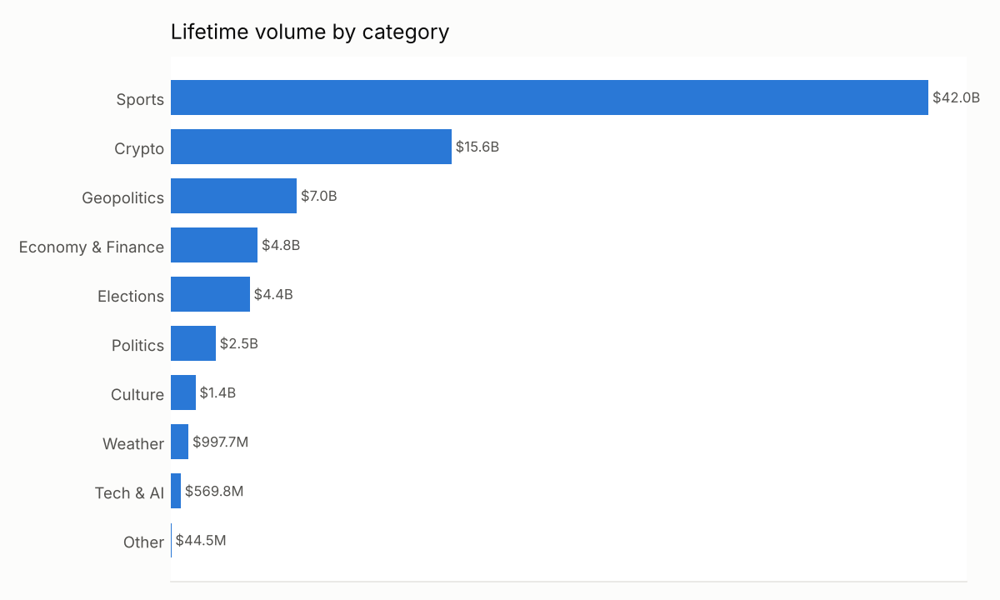
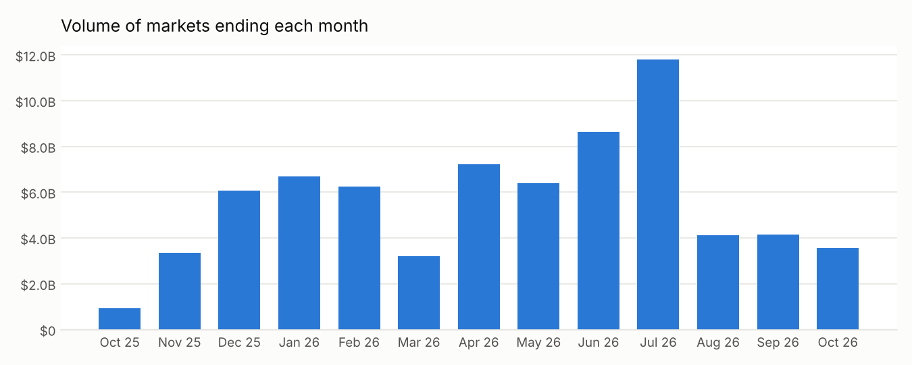
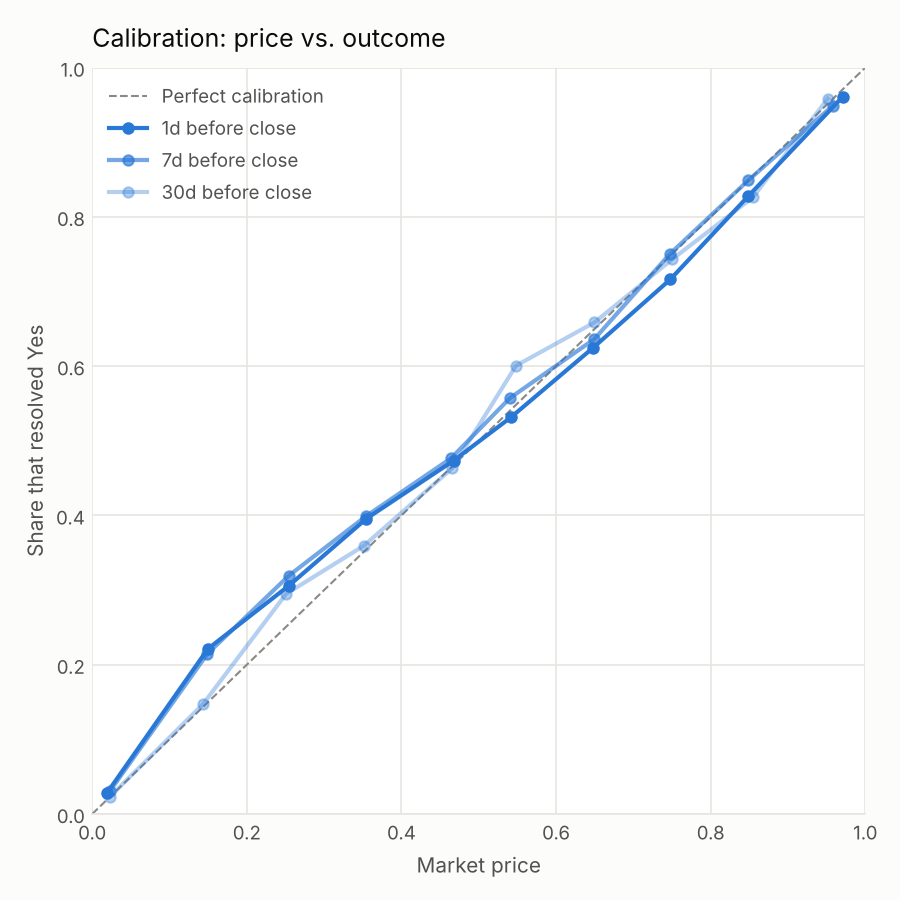

# Polymarket: one year in data

Generated 2026-10-25 from Polymarket's public Gamma and CLOB APIs. Covers every market whose end date falls on or after 2025-10-25 (resolved during the year, or still open).

Volume figures are each market's lifetime traded volume as reported by Polymarket, so a market that opened before the window counts its earlier volume too.

## Overview

| Metric | Value |
|---|---:|
| Markets | 4,895,978 |
| Events (groups of related markets) | 1,168,051 |
| Markets that ever traded | 2,415,957 |
| Closed | 4,621,404 |
| Resolved Yes / No (first outcome) | 1,561,332 / 2,994,157 |
| Still open | 274,574 |
| Total lifetime volume | $79.3B |
| Median volume per traded market | $561 |
| Markets with >= $10K volume | 418,314 |
| Markets with >= $1M volume | 9,470 |

Volume is highly concentrated: the top 1% of markets account for **74%** of all volume.

## By category

Categories are derived from each event's tags (first match wins; see `CATEGORIES` in `polymkt/analyze.py`).

| Category | Markets | Volume | Share of volume |
|---|---:|---:|---:|
| Sports | 3,462,142 | $42.0B | 53.0% |
| Crypto | 1,046,373 | $15.6B | 19.6% |
| Geopolitics | 20,240 | $7.0B | 8.8% |
| Economy & Finance | 65,093 | $4.8B | 6.1% |
| Elections | 43,074 | $4.4B | 5.5% |
| Politics | 25,228 | $2.5B | 3.2% |
| Culture | 35,889 | $1.4B | 1.7% |
| Weather | 180,283 | $997.7M | 1.3% |
| Tech & AI | 16,430 | $569.8M | 0.7% |
| Other | 1,226 | $44.5M | 0.1% |

## Over time

| Month | Markets ending | Their volume |
|---|---:|---:|
| 2025-10 | 8,678 | $941.1M |
| 2025-11 | 48,702 | $3.4B |
| 2025-12 | 76,751 | $6.1B |
| 2026-01 | 118,695 | $6.7B |
| 2026-02 | 117,213 | $6.2B |
| 2026-03 | 207,011 | $3.2B |
| 2026-04 | 257,467 | $7.2B |
| 2026-05 | 285,066 | $6.4B |
| 2026-06 | 311,551 | $8.6B |
| 2026-07 | 407,541 | $11.8B |
| 2026-08 | 730,079 | $4.1B |
| 2026-09 | 985,587 | $4.1B |
| 2026-10 | 1,064,580 | $3.6B |

## Market lifespan (start to scheduled end)

| Lifespan | Markets | Volume |
|---|---:|---:|
| < 1 hour | 339,347 | $517.0M |
| 1 hour - 1 day | 1,261,487 | $9.7B |
| 1 - 7 days | 1,397,803 | $21.5B |
| 1 - 4 weeks | 1,722,006 | $18.5B |
| 1 - 6 months | 98,981 | $12.5B |
| > 6 months | 41,753 | $16.5B |

## Biggest markets

| # | Market | Category | Volume | Status |
|---:|---|---|---:|---|
| 1 | [MicroStrategy sells any Bitcoin by May 31, 2026?](https://polymarket.com/event/microstrategy-sell-any-bitcoin-in-2025) | Crypto | $375.8M | Resolved No |
| 2 | [Fed decreases interest rates by 50+ bps after January 2026 meeting?](https://polymarket.com/event/fed-decision-in-january) | Economy & Finance | $235.1M | Resolved No |
| 3 | [Fed increases interest rates by 25+ bps after January 2026 meeting?](https://polymarket.com/event/fed-decision-in-january) | Economy & Finance | $216.5M | Resolved No |
| 4 | [US x Iran ceasefire extended by April 22, 2026?](https://polymarket.com/event/us-x-iran-ceasefire-extended-by) | Geopolitics | $203.6M | Resolved No |
| 5 | [US x Iran permanent peace deal by June 15, 2026?](https://polymarket.com/event/us-x-iran-permanent-peace-deal-by) | Geopolitics | $177.4M | Resolved Yes |
| 6 | [Will Argentina win the 2026 FIFA World Cup?](https://polymarket.com/event/world-cup-winner) | Sports | $174.3M | Resolved No |
| 7 | [Will the Fed increase interest rates by 25+ bps after the March 2026 meeting?](https://polymarket.com/event/fed-decision-in-march-885) | Economy & Finance | $173.0M | Resolved No |
| 8 | [Fed decreases interest rates by 50+ bps after December 2025 meeting?](https://polymarket.com/event/fed-decision-in-december) | Economy & Finance | $161.6M | Resolved No |
| 9 | [Will Egypt win the 2026 FIFA World Cup?](https://polymarket.com/event/world-cup-winner) | Sports | $158.6M | Resolved No |
| 10 | [US government shutdown Saturday?](https://polymarket.com/event/will-there-be-another-us-government-shutdown-by-january-31) | Politics | $157.3M | Resolved Yes |
| 11 | [Will Morocco win the 2026 FIFA World Cup?](https://polymarket.com/event/world-cup-winner) | Sports | $152.3M | Resolved No |
| 12 | [Will Spain win the 2026 FIFA World Cup?](https://polymarket.com/event/world-cup-winner) | Sports | $152.2M | Resolved Yes |
| 13 | [Will Zohran Mamdani win the 2025 NYC mayoral election?](https://polymarket.com/event/new-york-city-mayoral-election) | Elections | $143.3M | Resolved Yes |
| 14 | [Will USA win the 2026 FIFA World Cup?](https://polymarket.com/event/world-cup-winner) | Sports | $142.5M | Resolved No |
| 15 | [Russia x Ukraine ceasefire by May 31, 2026?](https://polymarket.com/event/russia-x-ukraine-ceasefire-by-may-31-2026) | Geopolitics | $141.3M | Resolved Yes |
| 16 | [Will Mexico win the 2026 FIFA World Cup?](https://polymarket.com/event/world-cup-winner) | Sports | $137.8M | Resolved No |
| 17 | [Will Norway win the 2026 FIFA World Cup?](https://polymarket.com/event/world-cup-winner) | Sports | $137.3M | Resolved No |
| 18 | [Fed increases interest rates by 25+ bps after December 2025 meeting?](https://polymarket.com/event/fed-decision-in-december) | Economy & Finance | $133.2M | Resolved No |
| 19 | [Will Switzerland win the 2026 FIFA World Cup?](https://polymarket.com/event/world-cup-winner) | Sports | $132.8M | Resolved No |
| 20 | [Will France win the 2026 FIFA World Cup?](https://polymarket.com/event/world-cup-winner) | Sports | $132.4M | Resolved No |
| 21 | [Khamenei out as Supreme Leader of Iran by February 28?](https://polymarket.com/event/khamenei-out-as-supreme-leader-of-iran-by-february-28) | Geopolitics | $131.1M | Resolved Yes |
| 22 | [Will Belgium win the 2026 FIFA World Cup?](https://polymarket.com/event/world-cup-winner) | Sports | $129.3M | Resolved No |
| 23 | [Will Trump nominate Judy Shelton as the next Fed chair?](https://polymarket.com/event/who-will-trump-nominate-as-fed-chair) | Economy & Finance | $127.7M | Resolved No |
| 24 | [Will Cape Verde win the 2026 FIFA World Cup?](https://polymarket.com/event/world-cup-winner) | Sports | $119.2M | Resolved No |
| 25 | [Will Ivory Coast win the 2026 FIFA World Cup?](https://polymarket.com/event/world-cup-winner) | Sports | $111.7M | Resolved No |

## How accurate were the prices?

Resolved markets with price history: **85,949**. For each one we take the last daily price of the first outcome (usually "Yes") 1, 7 and 30 days before close, then compare with how it resolved. A well-calibrated market resolves Yes about 70% of the time when priced at 70c.

| Snapshot | Markets | Brier score (lower is better) | Favorite won |
|---|---:|---:|---:|
| 1 day before | 55,742 | 0.170 | 71.5% |
| 7 days before | 26,700 | 0.159 | 73.8% |
| 30 days before | 8,150 | 0.095 | 86.1% |

By category, 1 day before close:

| Category | Markets | Brier score | Favorite won |
|---|---:|---:|---:|
| Sports | 35,823 | 0.209 | 65.0% |
| Crypto | 9,810 | 0.140 | 74.8% |
| Politics | 3,338 | 0.060 | 91.6% |
| Geopolitics | 2,776 | 0.055 | 92.0% |
| Economy & Finance | 1,502 | 0.064 | 90.0% |
| Culture | 935 | 0.057 | 92.8% |
| Tech & AI | 654 | 0.037 | 94.6% |
| Elections | 582 | 0.044 | 94.3% |
| Weather | 238 | 0.177 | 78.2% |
| Other | 84 | 0.081 | 90.5% |

How to read this: bars are daily, and the snapshot is the last bar at least N days before the market closed. For short markets (most sports games, daily crypto) that is a price from before the game or window even started, so the 1-day score is mostly a measure of pre-event forecasts, not of how close prices get to the answer. Long-dated markets - mostly "Will X happen by date?" questions that resolve No and sit at low prices - dominate the 7- and 30-day snapshots, which is why those scores look better. Compare categories rather than snapshots.

